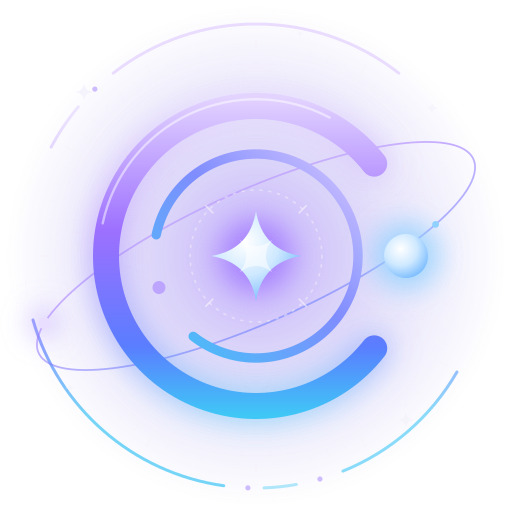

<p align="center">
  
</p>

<h1 align="center">codeonym · the living record</h1>

<p align="center">
  <strong>An agentic portfolio.</strong> An AI agent answers as me, in the first person, by text or by voice,<br />
  and shows my record while it talks.
</p>

<p align="center">
  <a href="https://portfolio.codeonym.work"><strong>portfolio.codeonym.work</strong></a> ·
  <a href="https://portfolio.codeonym.work/interview">Interview me</a> ·
  <a href="https://portfolio.codeonym.work/record">Plain record</a>
</p>

---

A portfolio usually asks you to read it. This one is a conversation. You ask what you would ask in an interview
("what have you built?", "are you a fit for this role?"). The agent answers from my record, in my voice, and shows
the evidence as it goes: it opens the right section, brings a project forward, or builds a case for you to keep.

## Two ways in

### The living record: `/`

The home page has no pages. An obsidian **Monolith** holds the agent, and every entry of my CV (each project, job,
skill, degree and document) is a shard in orbit around it, in six sections: Profile, Experience, Projects, Skills,
Documents and Contact.

- **Ask, and the place answers.** The agent opens sections, inspects entries and lights the shards it is talking
  about. Every tool call appears live in a run trace, with its arguments and duration. Nothing is staged.
- **Case files.** For a judgement question, it picks two to seven pieces of evidence from the record and writes one
  honest line on each. The case lives in the URL, so it can be shared and reopens without the agent.
- **My GitHub, live:** the year's contribution calendar, streaks, my weeks and years, languages, and the repositories
  I commit to most. Only public work is named.
- **The brief:** a one-minute read for hiring teams.

### The interview room: `/interview`

The same agent, face to face. My avatar sits at a desk in an office. It blinks, breathes, looks at you, and its jaw
follows the voice.

- Type, or **hold V** to talk. It answers aloud (or in text only), in English, French or Arabic.
- What it shows is laid on a table beside it and stays there for the whole conversation.
- The **transcript** opens as a leather-bound book of diaries, one for each conversation, and exports as a PDF that
  ends with my CV and my card.
- My **business card**, dark metal with the mark carved in it, turns over and saves as a vCard.

## The agent

It is me, answering a stranger the way I would in a job interview.

- **Grounded.** It answers only from the record (`src/config`) and my own answers to common interview questions
  (`interview.config.ts`).
- **It knows what is mine to answer.** Salary, start dates, offers, or an opinion the record doesn't state: it
  doesn't guess. It says I'd rather discuss it directly, and offers my card.
- **Honest.** Asked sincerely, it never claims to be human, and a line under the console says the answers are
  generated.
- **It acts.** A text agent answers *with the page*, through tools. A voice agent talks and hands the work to the text
  agent in the background, so speech never waits on the screen.
- **It degrades gracefully.** With no model (offline, no key, rate-limited), a local index answers the same message
  and says it can't reason. **⌘K** runs every command by hand. `/record` and `/llms.txt` serve the whole record as
  text.

| Role | Model (via OpenRouter) | Why |
|---|---|---|
| Conversation | `anthropic/claude-haiku-5.5`, no reasoning | ~1 s to the first token with tools, on its fastest providers; the fixed prompt is cached |
| Listening | `mistralai/voxtral-mini-transcribe-3-0` | 0.5–0.7 s, right in English, French and Arabic |
| Speaking | `x-ai/grok-voice-tts-1.0`, voice `rex` | 0.4 s to the first audio, streamed |

All three are set by environment variables and can change without a code change. The agent's design, its tools,
the voice pipeline, retention and guards are in [`src/agent/README.md`](src/agent/README.md).

## Stack

- **Next.js 16** (App Router, Turbopack) · React 19 · TypeScript · Tailwind CSS 4
- **3D:** three.js through React Three Fiber, drei and postprocessing. The Monolith, shards and brand are generated in
  Blender, and the avatar and office are Hyper3D Rodin models ([`scripts/assets`](scripts/assets/README.md)).
- **Agent:** LangChain `createAgent`, served in-process through CopilotKit v2 (`/api/copilotkit`), models through
  OpenRouter, traces in LangSmith
- **State:** zustand · **Motion:** motion · **PDF:** React-PDF
- Deployed on **Vercel** from `main`

## Run it

```bash
pnpm install
cp .env.example .env.local   # OPEN_ROUTER_API_KEY is the one required key
pnpm dev                     # http://localhost:3000
```

| Command | Does |
|---|---|
| `pnpm dev` | Development server |
| `pnpm build && pnpm start` | Production build |
| `pnpm lint` | ESLint |
| `pnpm test` | Unit tests (Node's test runner, `src/**/*.test.ts`) |

Every variable is listed in [`.env.example`](.env.example) and explained in
[`src/agent/README.md`](src/agent/README.md#environment). Without a key, the site still works on its local index.

## Where things are

| Path | What |
|---|---|
| `src/config/` | The content: profile, experience, projects, skills, documents, interview answers ([README](src/config/README.md)) |
| `src/agent/` | Both agents, their prompts, tools, voice pipeline and the local index ([README](src/agent/README.md)) |
| `src/record/` | The record as data: the shards, case files, `/record` and `/llms.txt` |
| `src/components/scene/` | The Monolith and its orbit |
| `src/components/interview/` | The interview room: avatar, office, table, transcript, card |
| `src/components/interface/` | The home page's header, windows, console and run trace |
| `src/github/` | My GitHub activity, read with a read-only token |
| `scripts/assets/` | How every model, image and sound was made, and its license |

Edit the content in `src/config` and everything follows: the scene, the windows, the agent's grounding and the
plain-text routes.

## Keys

| Key | Does |
|---|---|
| **/** or **T** | Ask the agent |
| hold **V** | Talk to it |
| **⌘K** / **Ctrl K** | Command palette |
| **1–6** | Open a section |
| **Q** | Jump to the section bar |
| **Esc** | Close what is open |
| **M** | Sound on or off |
| **F** | Fullscreen |

## Contributing

`main` is protected: every change goes through a pull request named after its issue. Issues, milestones and labels
are on [GitHub Issues](https://github.com/codeonym-org/portfolio/issues), and the workflow is in
[`docs/agents/issue-tracker.md`](docs/agents/issue-tracker.md).

## License

**All rights reserved.** The source is public to be read, not reused. No part of the code, design, content or assets
may be copied, modified, redistributed or used to build another site or product without written permission. See
[`LICENSE`](LICENSE). Third-party assets keep their own licenses
([`scripts/assets/README.md`](scripts/assets/README.md)).
